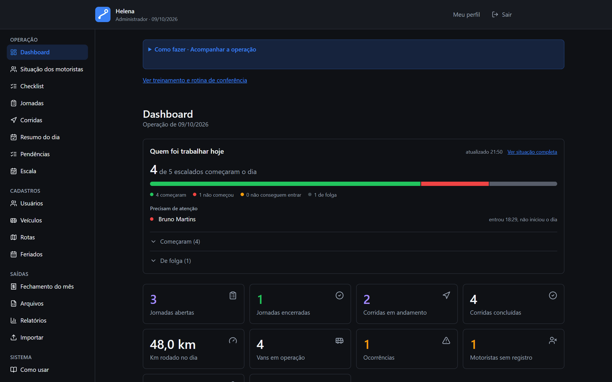
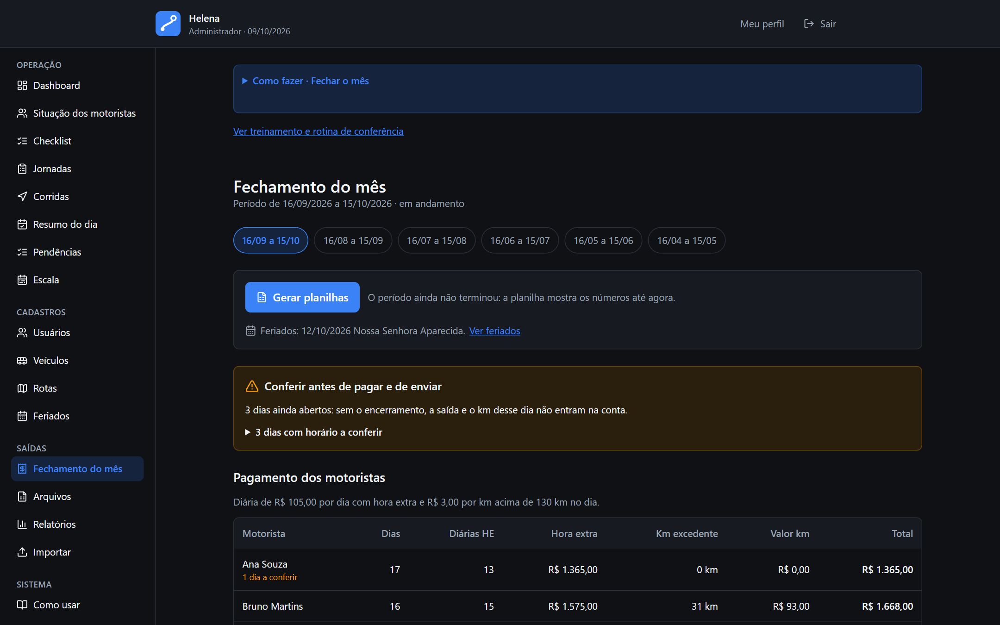
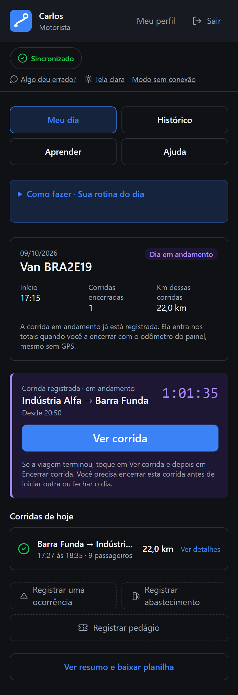
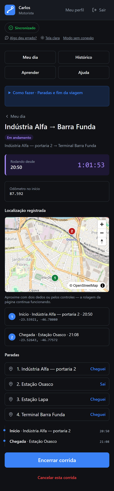
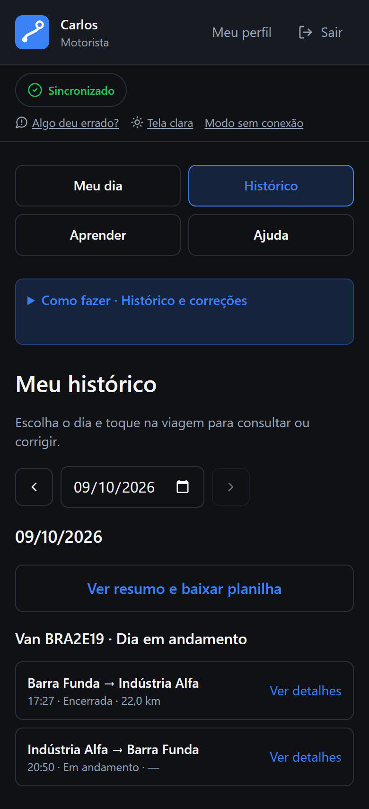

# Bordo — Digital Logbook for Van Fleets

[Versão em português](README.md)

A web app that replaces the paper logbook of a van fleet. Drivers record their day on their phones —
shift, trips, stops, location, incidents, refueling and tolls — while the office follows the
operation live, closes the month (overtime, excess mileage and per-contract billing reports) and
exports everything to Excel.

> **Real project, portfolio edition.** Bordo was built for a van transportation company and deployed
> to production. In this repository the client's brand, documents and data have been removed.
> **Every name, plate, route and number shown on screen is fictional**, generated by
> `npm run seed:demo`.

The codebase, the UI and the documentation are in Brazilian Portuguese, the language of the people
who use it. This page is the English overview.


## Screens

**Back office** — live dashboard and monthly closing:





**Driver** — on the phone, installable as an app:

<p>
  
  &nbsp;
  
  &nbsp;
  
</p>

## The problem

The fleet was tracked on a paper sheet that drivers forgot, half-filled or filled from memory at the
end of the day. Someone in the office retyped it all into Excel, and the company never knew for sure
how many kilometers each van drove, which routes actually ran, or how much overtime to pay.

That shaped the core design decision: **recording has to take less effort than not recording.**
Date, time and location come from the device; the route comes from the registry; the driver only
confirms what the machine can't know — odometer, passengers and incidents.

## What it does

**Driver** (phone, installable PWA, works without signal)

- Opens the day by picking a van, with odometer checks and a configurable tolerance.
- Records trips on registered routes or ad hoc, with a timer, arrival and departure at each stop, and
  a GPS capture that **never blocks** the record.
- Logs incidents, refueling and tolls.
- Works offline: actions queue on the device and sync idempotently when the connection returns,
  without duplicates.
- Browses their own history, fixes a record within a time window, and can rehearse the routine in a
  demo mode that sends nothing.

**Back office**

- Live dashboard: who started the day, who didn't, trips in progress, mileage and incidents.
- Daily roster (driver × van × shift × routes), days off and a holiday calendar.
- Shift and trip search with filters, a printable daily summary and Excel export.
- **Monthly closing:** a flat overtime allowance driven by schedule rules (weekdays, Friday to
  Sunday, holidays and night shift), excess mileage pay and a per-contract billing report —
  generated as spreadsheets.
- Bulk import of users, vans and routes from a spreadsheet, with a row-by-row error report.
- Audit trail with the previous and new value of every change.
- Pending-item alerts and a daily summary ready to send over WhatsApp.
- Privacy notice with recorded consent and configurable data retention (Brazil's LGPD).

## Technical highlights

- **Modular monolith** on Next.js (App Router, Server Components and Server Actions), split into 30
  domain modules. Each module separates pure rules (`*.regras.ts`), use cases (`*.servico.ts`),
  data access (`*.repositorio.ts`) and validation (`*.schema.ts`, with Zod).
- **Every write goes through the same pipeline:** [`definirAcao`](src/lib/acao-segura.ts) runs
  session → permission → validation → transaction → audit. There is no write path outside it.
- **Pure, tested business rules:** 829 unit tests with Vitest, plus end-to-end HTTP suites that
  start a throwaway PostgreSQL and drive the system with real sessions.
- **Concurrency enforced by the database**, not just the code: partial unique indexes prevent two
  open shifts on the same van, two trips in progress on the same shift, or two days for the same
  driver.
- **Transactional background exports:** the request is written to a task table in the same
  transaction that audits it, so there's never queued work for a request the database says never
  happened. Benchmarked up to 200,000 rows.
- **Security:** database-backed sessions with opaque tokens, Argon2id password hashing (OWASP
  parameters), lockout after failed attempts, login rate limiting, per-request CSP nonces and
  layered authorization (middleware, layout and action).
- **No date surprises:** instants stored in UTC, an "operational date" in the São Paulo time zone,
  and money computed in cents.
- **Two documented and tested deployment paths:** containers (Docker Compose + Caddy with automatic
  TLS, scheduled jobs on pg-boss) and Vercel + Neon (with Vercel Cron), plus encrypted backups with a
  restore drill.
- **Product and engineering docs:** 31 documents, from requirements and business rules to
  architecture, API, security and privacy, traceable from requirement to rule, user story, screen,
  endpoint and test.

## Stack

| Layer        | Technology                                                      |
| ------------ | --------------------------------------------------------------- |
| Application  | Next.js 15, React 19, TypeScript                                |
| UI           | Tailwind CSS 4, lucide-react, MapLibre GL (OpenStreetMap tiles) |
| Data         | PostgreSQL 16, Prisma 6                                         |
| Validation   | Zod                                                             |
| Spreadsheets | ExcelJS                                                         |
| Auth         | Custom database sessions, Argon2id                              |
| Jobs         | pg-boss (containers) or Vercel Cron                             |
| Quality      | Vitest, ESLint, Prettier, GitHub Actions                        |
| Deployment   | Docker Compose + Caddy, or Vercel + Neon                        |

## Running the demo

Requirements: **Node 22+** and **PostgreSQL 16**. With Docker, one command starts the database:

```bash
docker run -d --name bordo-db -e POSTGRES_USER=bordo -e POSTGRES_PASSWORD=bordo -e POSTGRES_DB=bordo -p 5432:5432 postgres:16-alpine
```

Install dependencies and create `.env` from the example. The example URLs already point at the
database above; only replace `SESSAO_SECRET`:

```bash
npm ci
cp .env.example .env
node -e "console.log(require('crypto').randomBytes(48).toString('base64'))"
```

Create the tables, generate the fictional operation and start the server:

```bash
npx prisma migrate deploy
npm run seed:demo
npm run dev
```

`seed:demo` creates a made-up transport company: one administrator, seven drivers, six vans with
contracts, three round-trip routes and eight weeks of operations. Today is left in progress, with a
trip running, an open day, a closed day and a rostered driver who hasn't started yet.

It prints the credentials at the end. Sign in at <http://localhost:3000> with:

| Role        | CPF              | Password            |
| ----------- | ---------------- | ------------------- |
| Back office | `529.982.247-25` | printed by the seed |
| Driver      | `100.000.001-08` | the same one        |

The password is generated on every run — the project has no hard-coded passwords. To pick one, set
`DEMO_SENHA` before running the seed.

To start over: `npx prisma migrate reset --force --skip-seed`, then `npm run seed:demo`.

### Checks

```bash
npm run verificar
```

Runs what CI runs: formatting, lint, type checking and the unit tests.

---

Built by **Pedro Henrique** · [github.com/PedroSntos194](https://github.com/PedroSntos194)
