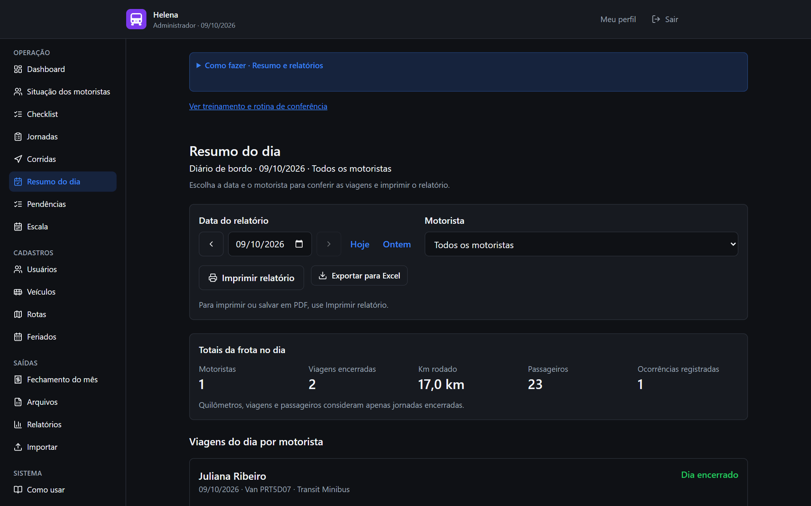
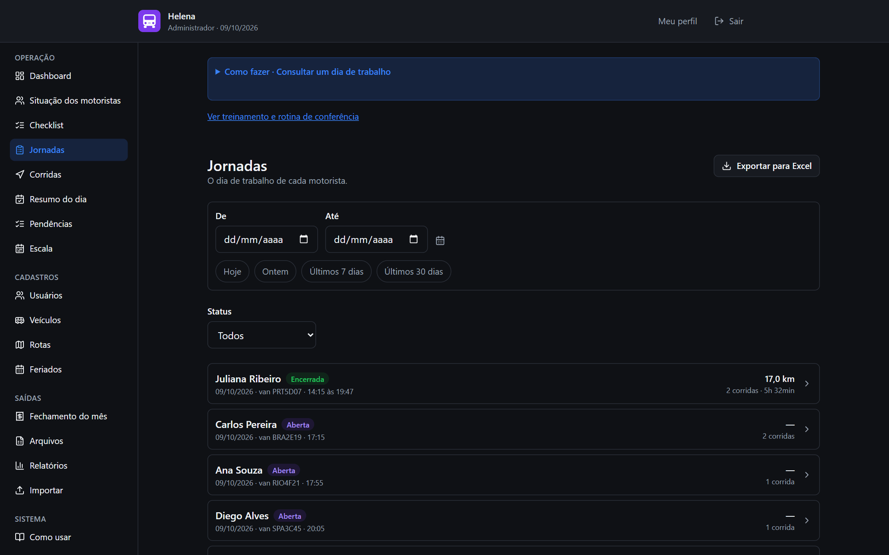
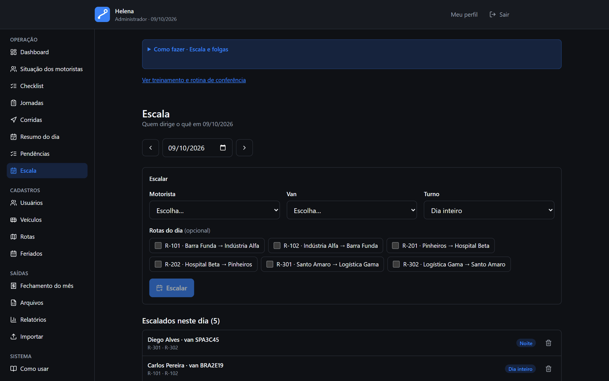
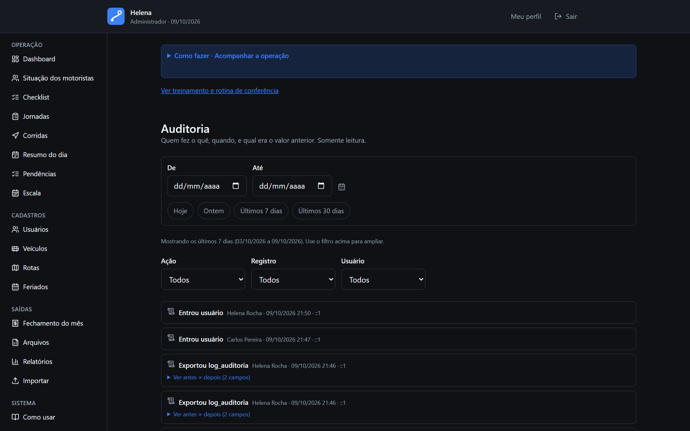

<p align="center">
  
</p>

# Bordo — Diário de Bordo Digital

[English version](README.en.md)

Sistema web que substitui o diário de bordo em papel de uma frota de vans. O motorista registra o
dia pelo celular — jornada, corridas, paradas, localização, ocorrências, abastecimento e pedágio — e
a administração acompanha a operação ao vivo, fecha o mês (hora extra, km excedente e boletim de
medição por contrato) e exporta tudo para Excel.

> **Projeto real, versão de portfólio.** O Bordo foi desenvolvido para uma empresa de transporte por
> vans e implantado em produção. Neste repositório, a marca, os documentos e os dados do cliente
> foram removidos. **Todos os nomes, placas, rotas e números que aparecem nas telas são fictícios**,
> gerados por `npm run seed:demo`.


## Apresentar o projeto

Abra o [portfólio publicado](https://bordo-diario-de-bordo-portfolio.vercel.app) para apresentar
o projeto e experimentar a demonstração com dados fictícios, sem cadastrar usuários ou preparar
jornadas. Para abrir a mesma versão no seu computador:

```bash
npm ci
npm run preview:portfolio
```

Acesse <http://localhost:3001>. A prévia gera e serve somente a apresentação e a demonstração,
sem `.env`, PostgreSQL ou login. Nela, um endereço antigo como `/login` leva à demonstração.
O comando `npm run dev` é destinado ao **sistema completo**: para usá-lo, configure o ambiente
e o banco seguindo a seção [Como rodar a demonstração](#como-rodar-a-demonstração).

O site público de portfólio publica apenas a apresentação e a demonstração interativa. Para
gerar essa versão, execute `npm run build:portfolio`; os arquivos ficam em
`output/portfolio-build/out`. Ela não exige banco, login ou variáveis de ambiente. O `vercel.json`
deste repositório usa esse build estático, sem APIs e sem rotinas agendadas. O botão **Ver código**
leva ao repositório. Para executar o sistema completo localmente, siga as instruções abaixo.

No sistema completo, visitantes sem sessão chegam à apresentação ao abrir a raiz; quem já entrou
continua sendo encaminhado à área do seu perfil.

O [roteiro de 5 a 7 minutos](docs/37-roteiro-de-apresentacao.md) sugere a ordem da demonstração,
as decisões técnicas a destacar e os limites a explicar. Para conhecer a operação completa, com
login, persistência, sincronização e exportações reais, siga [Como rodar a demonstração](#como-rodar-a-demonstração):
esse fluxo exige PostgreSQL, migrações e o seed fictício.

## Telas

**Administração** — painel do dia e fechamento do mês:


**Motorista** — no celular, instalável como aplicativo:

<p>
  
  &nbsp;
  
  &nbsp;
  
</p>

<details>
<summary>Mais telas</summary>






</details>

## O problema

O controle das vans era feito numa folha de papel que os motoristas esqueciam, preenchiam pela
metade ou de cabeça no fim do dia. Alguém no escritório redigitava tudo em Excel, e a empresa não
sabia com segurança quantos km cada van rodou, quais rotas foram feitas nem quanto pagar de hora
extra.

A decisão central do projeto saiu daí: **registrar precisa dar menos trabalho do que não
registrar**. Data, hora e localização vêm do aparelho; a rota vem do cadastro; o motorista só
confirma o que a máquina não sabe — odômetro, passageiros e ocorrências.

## O que o sistema faz

**Motorista** (celular, PWA instalável, funciona sem sinal)

- Abre o dia escolhendo a van, com conferência do odômetro e tolerância configurável.
- Registra corridas por linha cadastrada ou avulsas, com cronômetro, chegada e saída em cada parada e
  captura de GPS que **nunca bloqueia** o registro.
- Registra ocorrências, abastecimentos e pedágios.
- Trabalha offline: as ações entram numa fila no aparelho e sincronizam de forma idempotente quando
  a conexão volta, sem duplicar registro.
- Consulta o próprio histórico, corrige um registro dentro do prazo e pode treinar a rotina num modo
  de demonstração que não envia nada.

**Administração**

- Painel ao vivo: quem começou o dia, quem não começou, corridas em andamento, km e ocorrências.
- Escala diária (motorista × van × turno × linhas), folgas e calendário de feriados.
- Consulta de jornadas e corridas com filtros, resumo do dia imprimível e exportação para Excel.
- **Fechamento mensal:** diária de hora extra por regra de horário (dia útil, sexta a domingo,
  feriado e turno da noite), km excedente do motorista e boletim de medição por contrato de van —
  gerados como planilhas.
- Importação em lote de usuários, vans e rotas por planilha, com relatório de erros linha a linha.
- Trilha de auditoria com o valor anterior e o novo de cada alteração.
- Alertas de pendência e resumo do dia prontos para enviar por WhatsApp.
- Aviso de privacidade com registro de aceite e retenção de dados configurável (LGPD).

## Destaques técnicos

- **Monólito modular** em Next.js (App Router, Server Components e Server Actions), dividido em 30
  módulos de domínio. Cada módulo separa regras puras (`*.regras.ts`), casos de uso
  (`*.servico.ts`), acesso a dados (`*.repositorio.ts`) e validação (`*.schema.ts`, com Zod). O
  porquê de não ter backend separado está em [`docs/13`](docs/13-arquitetura.md).
- **Toda mutação passa pelo mesmo funil:** [`definirAcao`](src/lib/acao-segura.ts) faz sessão →
  permissão → validação → transação → auditoria. Não existe escrita fora dele.
- **Regras de negócio puras e testadas:** 837 testes unitários com Vitest, mais suítes HTTP ponta a
  ponta que sobem um PostgreSQL descartável e exercitam o sistema com sessões reais.
- **Concorrência garantida no banco**, não só no código: índices parciais impedem duas jornadas
  abertas na mesma van, duas corridas em andamento na mesma jornada ou dois dias para o mesmo
  motorista.
- **Exportação em segundo plano transacional:** o pedido entra numa tabela de tarefas na mesma
  transação que o audita — nunca há trabalho na fila para um pedido que o banco diz não existir.
  Medida com até 200 mil linhas ([`docs/31`](docs/31-medicao-exportacao.md)).
- **Segurança:** sessão em banco com token opaco, senhas com Argon2id (parâmetros do OWASP),
  bloqueio por tentativas, limite de requisições no login, CSP com nonce por requisição e
  autorização em camadas (middleware, layout e ação).
- **Datas sem surpresa:** instantes gravados em UTC, "data operacional" no fuso de São Paulo e
  dinheiro calculado em centavos.
- **Dois caminhos de implantação documentados e testados:** contêiner (Docker Compose + Caddy com
  TLS automático e rotinas agendadas com pg-boss) e Vercel + Neon (com Vercel Cron), além de backup
  criptografado com ensaio de restauração.
- **Documentação de produto e engenharia:** 32 documentos, de requisitos e regras de negócio a
  arquitetura, API, segurança e LGPD, com rastreabilidade
  `requisito → regra → user story → tela → endpoint → teste`.

## Stack

| Camada | Tecnologia |
| --- | --- |
| Aplicação | Next.js 15, React 19, TypeScript |
| Interface | Tailwind CSS 4, lucide-react, MapLibre GL (mapas OpenStreetMap) |
| Dados | PostgreSQL 16, Prisma 6 |
| Validação | Zod |
| Planilhas | ExcelJS |
| Autenticação | Sessão própria em banco, Argon2id |
| Rotinas | pg-boss (contêiner) ou Vercel Cron |
| Qualidade | Vitest, ESLint, Prettier, GitHub Actions |
| Implantação | Docker Compose + Caddy, ou Vercel + Neon |

## Como rodar a demonstração

Pré-requisitos: **Node 22+** e um **PostgreSQL 16**. Se tiver Docker, um comando sobe o banco:

```bash
docker run -d --name bordo-db -e POSTGRES_USER=bordo -e POSTGRES_PASSWORD=bordo -e POSTGRES_DB=bordo -p 5432:5432 postgres:16-alpine
```

Instale as dependências e crie o `.env` a partir do exemplo. As URLs do exemplo já apontam para o
banco acima; troque só o `SESSAO_SECRET`:

```bash
npm ci
cp .env.example .env
node -e "console.log(require('crypto').randomBytes(48).toString('base64'))"
```

Crie as tabelas, gere a operação fictícia e suba o servidor:

```bash
npx prisma migrate deploy
npm run seed:demo
npm run dev
```

Para processar exportações com mais de 5.000 registros e executar as rotinas automáticas locais,
inicie também `npm run agendador` em outro terminal. O servidor web e o agendador são processos
separados.

O `seed:demo` cria uma transportadora inventada: uma administradora, sete motoristas, seis vans com
contrato, três linhas de ida e volta e oito semanas de operação. O dia de hoje fica em andamento,
com corrida rodando, dia aberto, dia encerrado e um motorista escalado que ainda não começou.

Ao final ele imprime as credenciais. Entre em <http://localhost:3000> com:

| Perfil | CPF | Senha |
| --- | --- | --- |
| Administração | `529.982.247-25` | a que o seed imprimir |
| Motorista | `100.000.001-08` | a mesma |

A senha é gerada a cada execução — o projeto não tem senha fixa no código. Para escolher uma, defina
`DEMO_SENHA` antes de rodar o seed.

Para recomeçar do zero: `npx prisma migrate reset --force --skip-seed` e `npm run seed:demo`.

### Verificação

```bash
npm run verificar
```

Roda o mesmo que a CI: formatação, lint, tipos e os testes unitários.

## Documentação

| # | Documento | Conteúdo |
| --- | --- | --- |
| 00 | [Como navegar o código](docs/00-como-navegar-o-codigo.md) | **Comece aqui** — pastas, caminho de uma requisição, onde mexer |
| 01 | [Análise inicial e validações](docs/01-analise-inicial-e-validacoes.md) | Leitura crítica do levantamento, lacunas e pontos a validar |
| 02 | [Visão do produto](docs/02-visao-do-produto.md) | Problema, objetivo, público e proposta de valor |
| 03 | [Escopo e MVP](docs/03-escopo-e-mvp.md) | Dentro e fora do escopo, priorização MoSCoW |
| 04 | [Requisitos funcionais](docs/04-requisitos-funcionais.md) | RF001…RF044 |
| 05 | [Requisitos não funcionais](docs/05-requisitos-nao-funcionais.md) | RNF001…RNF024 |
| 06 | [Regras de negócio](docs/06-regras-de-negocio.md) | RN001…RN032 |
| 07 | [Backlog](docs/07-backlog.md) | Épicos, user stories e critérios de aceitação |
| 08 | [Perfis e permissões](docs/08-perfis-e-permissoes.md) | Matriz de permissões |
| 09 | [Fluxos](docs/09-fluxos.md) | Fluxos principais, alternativos e de erro |
| 10 | [Mapa de telas](docs/10-mapa-de-telas.md) | Telas, componentes e ações |
| 11 | [UX/UI](docs/11-ux-ui.md) | Diretrizes visuais, estados e acessibilidade |
| 12 | [Banco de dados](docs/12-banco-de-dados.md) | Entidades, relacionamentos e índices |
| 13 | [Arquitetura](docs/13-arquitetura.md) | Camadas, decisões (ADs) e infraestrutura |
| 14 | [Stack](docs/14-stack.md) | Tecnologias, justificativas e alternativas |
| 15 | [Estrutura do projeto](docs/15-estrutura-do-projeto.md) | Organização de pastas |
| 16 | [API](docs/16-api.md) | Endpoints, contratos e erros |
| 17 | [Segurança](docs/17-seguranca.md) | Autenticação, autorização e hardening |
| 18 | [Tratamento de erros](docs/18-tratamento-de-erros.md) | Padrão de erros no front e no back |
| 19 | [Plano de testes](docs/19-testes.md) | Estratégia e cenários |
| 20 | [Processo](docs/20-processo.md) | Definition of Ready e of Done, controle de mudanças |
| 21 | [Sprints e roadmap](docs/21-sprints-roadmap-estimativas.md) | Planejamento de execução |
| 22 | [Riscos e dependências](docs/22-riscos-dependencias.md) | Matriz de riscos |
| 23 | [Checklist e ordem](docs/23-checklist-e-ordem.md) | Sequência de implementação |
| 24 | [Implantação em contêiner](docs/24-implantacao.md) | Runbook com Docker Compose e Caddy |
| 26 | [LGPD](docs/26-lgpd-base-legal.md) | Inventário de dados e base legal |
| 27 | [Implantação na Vercel](docs/27-vercel.md) | Vercel + Neon, cron e backup |
| 30 | [Testes ponta a ponta](docs/30-testes-ponta-a-ponta.md) | Roteiros HTTP com sessões reais |
| 31 | [Medição da exportação](docs/31-medicao-exportacao.md) | Desempenho do Excel com até 200 mil linhas |
| 35 | [Fechamento mensal](docs/35-fechamento-mensal.md) | Hora extra, km excedente e boletim de medição |
| 36 | [Reabertura do dia](docs/36-reabertura-do-dia.md) | Reabrir um dia encerrado antes da hora |
| 37 | [Roteiro de apresentação](docs/37-roteiro-de-apresentacao.md) | Demonstração de 5 a 7 minutos, preparação e limites |

## Sobre esta versão

- O histórico de commits começa aqui: o repositório original, com o histórico de desenvolvimento,
  é privado.
- A marca do cliente foi trocada pela do Bordo, e os documentos da relação com o cliente
  (homologação, implantação assistida, atendimento) e os guias em PDF ficaram de fora.
- Valores padrão de tarifas e horários são exemplos configuráveis na tela de Configurações.

---

Desenvolvido por **Pedro Henrique** · [github.com/PedroSntos194](https://github.com/PedroSntos194)
