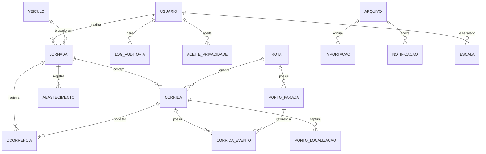

# 12 · Modelagem do banco de dados

**SGBD proposto:** PostgreSQL 16
**Convenções:** nomes em `snake_case` e singular · chaves primárias `uuid` (`gen_random_uuid()`) ·
datas/horas em `timestamptz` armazenadas em UTC · valores monetários em `numeric(12,2)` ·
coordenadas em `numeric(10,7)` · exclusão lógica por `status` + `excluido_em`.

Campos de auditoria presentes em toda entidade de negócio:
`criado_em`, `atualizado_em`, `criado_por`, `atualizado_por`, `status`.

---

## Diagrama de relacionamentos

---

## Entidades

### `usuario`
Pessoas com acesso ao sistema (motoristas e administradores).

| Campo | Tipo | Obrig. | Observação |
|---|---|---|---|
| `id` | uuid | Sim | **PK** |
| `nome` | varchar(120) | Sim | Nome completo |
| `cpf` | char(11) | Sim | Somente dígitos · **único entre ativos** |
| `telefone` | varchar(20) | Sim | Formato E.164, usado no WhatsApp |
| `email` | varchar(160) | Não | Reservado para evolução (V-07) |
| `matricula` | varchar(30) | Não | Único quando informado |
| `perfil` | enum(`ADMIN`,`MOTORISTA`) | Sim | RN008, RN009 |
| `senha_hash` | varchar(255) | Sim | Argon2id — nunca exposto |
| `deve_trocar_senha` | boolean | Sim | Padrão `true` |
| `senha_temporaria_expira_em` | timestamptz | Não | RN005 |
| `tentativas_login` | smallint | Sim | Padrão 0 · RN003 |
| `bloqueado_ate` | timestamptz | Não | Bloqueio temporário |
| `ultimo_login_em` | timestamptz | Não | — |
| `cnh_numero` | varchar(20) | Não | Somente perfil Motorista |
| `cnh_categoria` | varchar(5) | Não | — |
| `cnh_validade` | date | Não | Permite alerta de vencimento (evolução) |
| `status` | enum(`ATIVO`,`INATIVO`,`BLOQUEADO`,`EXCLUIDO`) | Sim | RN006 |
| `excluido_em` | timestamptz | Não | Exclusão lógica |
| `criado_em` / `atualizado_em` | timestamptz | Sim | — |
| `criado_por` / `atualizado_por` | uuid | Não | **FK** → `usuario.id` |

**Índices:** único parcial em `cpf` para `status <> 'EXCLUIDO'`; único parcial em `matricula`;
índice em `(perfil, status)`; índice em `nome` para busca.

### `veiculo`

| Campo | Tipo | Obrig. | Observação |
|---|---|---|---|
| `id` | uuid | Sim | **PK** |
| `placa` | varchar(8) | Sim | Único · formato antigo ou Mercosul |
| `modelo` | varchar(60) | Sim | — |
| `marca` | varchar(60) | Não | — |
| `ano` | smallint | Não | — |
| `capacidade_passageiros` | smallint | Sim | Valida RN em US019 |
| `odometro_atual` | integer | Sim | Em km · atualizado no encerramento (RN020) |
| `observacoes` | text | Não | — |
| `status` | enum(`ATIVO`,`INATIVO`,`MANUTENCAO`) | Sim | RN013 |
| auditoria | — | Sim | Campos padrão |

**Índices:** único em `placa`; índice em `status`.

### `rota`

| Campo | Tipo | Obrig. | Observação |
|---|---|---|---|
| `id` | uuid | Sim | **PK** |
| `codigo` | varchar(20) | Sim | Único |
| `nome` | varchar(120) | Sim | — |
| `origem` | varchar(160) | Sim | Descrição textual |
| `destino` | varchar(160) | Sim | — |
| `turno` | enum(`MANHA`,`TARDE`,`NOITE`,`INTEGRAL`) | Sim | — |
| `distancia_estimada_km` | numeric(7,2) | Não | Comparação planejado × realizado |
| `status` | enum(`ATIVA`,`INATIVA`) | Sim | RN021 |
| auditoria | — | Sim | Campos padrão |

**Índices:** único em `codigo`; índice em `(status, turno)`.

### `ponto_parada`

| Campo | Tipo | Obrig. | Observação |
|---|---|---|---|
| `id` | uuid | Sim | **PK** |
| `rota_id` | uuid | Sim | **FK** → `rota.id` · `ON DELETE CASCADE` |
| `ordem` | smallint | Sim | Sequência na rota |
| `nome` | varchar(120) | Sim | — |
| `endereco` | varchar(240) | Não | — |
| `latitude` | numeric(10,7) | Não | — |
| `longitude` | numeric(10,7) | Não | — |
| auditoria | — | Sim | Campos padrão |

**Índices:** único em `(rota_id, ordem)`; índice em `rota_id`.

### `escala` *(Could Have)*

| Campo | Tipo | Obrig. | Observação |
|---|---|---|---|
| `id` | uuid | Sim | **PK** |
| `data` | date | Sim | — |
| `motorista_id` | uuid | Sim | **FK** → `usuario.id` |
| `veiculo_id` | uuid | Sim | **FK** → `veiculo.id` |
| `rota_id` | uuid | Não | **FK** → `rota.id` |
| `turno` | enum | Não | — |
| auditoria | — | Sim | Campos padrão |

**Índices:** único em `(data, veiculo_id, turno)`; índice em `(data, motorista_id)`.

### `jornada`
O "dia" do motorista — entidade central do diário de bordo.

| Campo | Tipo | Obrig. | Observação |
|---|---|---|---|
| `id` | uuid | Sim | **PK** |
| `motorista_id` | uuid | Sim | **FK** → `usuario.id` |
| `veiculo_id` | uuid | Sim | **FK** → `veiculo.id` |
| `data` | date | Sim | Data operacional (fuso local) |
| `iniciada_em` | timestamptz | Sim | — |
| `encerrada_em` | timestamptz | Não | Nulo enquanto aberta |
| `odometro_inicial` | integer | Sim | RN015 |
| `odometro_final` | integer | Não | RN020 |
| `km_total` | numeric(8,2) | Não | Calculado (RN018) |
| `total_corridas` | smallint | Não | Calculado |
| `total_passageiros` | integer | Não | Calculado |
| `duracao_minutos` | integer | Não | Calculado |
| `observacoes` | text | Não | — |
| `client_uuid` | uuid | Não | Idempotência offline (RN025) · único |
| `status` | enum(`ABERTA`,`ENCERRADA`,`CANCELADA`) | Sim | RN017 |
| auditoria | — | Sim | Campos padrão |

**Índices:** **único em `(motorista_id, data)` para `status <> 'CANCELADA'`** (RN012);
único em `client_uuid`; índice em `(data, status)`; índice em `(veiculo_id, data)`;
índice parcial em `status = 'ABERTA'` para o dashboard.

### `corrida`

| Campo | Tipo | Obrig. | Observação |
|---|---|---|---|
| `id` | uuid | Sim | **PK** |
| `jornada_id` | uuid | Sim | **FK** → `jornada.id` |
| `rota_id` | uuid | Não | **FK** → `rota.id` · nulo em corrida avulsa |
| `origem_descricao` | varchar(160) | Não | Obrigatório se `rota_id` nulo |
| `destino_descricao` | varchar(160) | Não | Obrigatório se `rota_id` nulo |
| `iniciada_em` | timestamptz | Sim | — |
| `encerrada_em` | timestamptz | Não | RN016 |
| `odometro_inicial` | integer | Não | — |
| `odometro_final` | integer | Não | — |
| `km_percorrido` | numeric(7,2) | Não | Calculado |
| `duracao_minutos` | integer | Não | Calculado |
| `quantidade_passageiros` | smallint | Não | — |
| `observacoes` | text | Não | — |
| `motivo_cancelamento` | varchar(240) | Não | Obrigatório se cancelada |
| `editada_em` | timestamptz | Não | Marcação "editado" |
| `client_uuid` | uuid | Não | Idempotência offline · único |
| `status` | enum(`EM_ANDAMENTO`,`ENCERRADA`,`CANCELADA`) | Sim | — |
| auditoria | — | Sim | Campos padrão |

**Índices:** índice em `jornada_id`; índice em `(rota_id, iniciada_em)`; único em `client_uuid`;
índice parcial em `status = 'EM_ANDAMENTO'`.
**Restrição:** no máximo uma corrida `EM_ANDAMENTO` por jornada (RN014) — garantida por índice único
parcial em `jornada_id` onde `status = 'EM_ANDAMENTO'`.

### `corrida_evento`
Paradas e marcos registrados durante a corrida.

| Campo | Tipo | Obrig. | Observação |
|---|---|---|---|
| `id` | uuid | Sim | **PK** |
| `corrida_id` | uuid | Sim | **FK** → `corrida.id` · `ON DELETE CASCADE` |
| `ponto_parada_id` | uuid | Não | **FK** → `ponto_parada.id` |
| `tipo` | enum(`INICIO`,`CHEGADA`,`SAIDA`,`EMBARQUE`,`DESEMBARQUE`,`FIM`) | Sim | — |
| `descricao` | varchar(160) | Não | Nome livre em corrida avulsa |
| `ocorrido_em` | timestamptz | Sim | — |
| `client_uuid` | uuid | Não | Idempotência offline · único |
| `criado_em` / `criado_por` | — | Sim | Evento não é editável |

**Índices:** índice em `(corrida_id, ocorrido_em)`; único em `client_uuid`.

### `ponto_localizacao`
Coordenadas capturadas. Tabela de maior volume — sujeita à política de retenção (RNF007).

| Campo | Tipo | Obrig. | Observação |
|---|---|---|---|
| `id` | bigserial | Sim | **PK** (volume alto; uuid encareceria o índice) |
| `corrida_id` | uuid | Sim | **FK** → `corrida.id` · `ON DELETE CASCADE` |
| `corrida_evento_id` | uuid | Não | **FK** → `corrida_evento.id` |
| `latitude` | numeric(10,7) | Sim | — |
| `longitude` | numeric(10,7) | Sim | — |
| `precisao_metros` | numeric(7,2) | Não | Sinaliza baixa precisão |
| `origem` | enum(`GPS`,`REDE`,`MANUAL`) | Sim | RN022 |
| `capturado_em` | timestamptz | Sim | Relógio do dispositivo |
| `recebido_em` | timestamptz | Sim | Relógio do servidor — detecta atraso de sincronização |

**Índices:** índice em `(corrida_id, capturado_em)`; índice em `capturado_em` para a rotina de expurgo.
**Imutável:** sem `atualizado_em` — pontos não são editados (RN022).

### `ocorrencia`

| Campo | Tipo | Obrig. | Observação |
|---|---|---|---|
| `id` | uuid | Sim | **PK** |
| `jornada_id` | uuid | Sim | **FK** → `jornada.id` |
| `corrida_id` | uuid | Não | **FK** → `corrida.id` |
| `tipo` | enum(`ATRASO`,`PANE`,`ACIDENTE`,`DESVIO`,`PASSAGEIRO`,`OUTRO`) | Sim | — |
| `descricao` | text | Sim | — |
| `ocorrido_em` | timestamptz | Sim | — |
| `latitude` / `longitude` | numeric(10,7) | Não | — |
| auditoria | — | Sim | Campos padrão |

**Índices:** índice em `jornada_id`; índice em `(tipo, ocorrido_em)`.

### `abastecimento` *(Could Have)*

| Campo | Tipo | Obrig. | Observação |
|---|---|---|---|
| `id` | uuid | Sim | **PK** |
| `jornada_id` | uuid | Sim | **FK** → `jornada.id` |
| `veiculo_id` | uuid | Sim | **FK** → `veiculo.id` |
| `abastecido_em` | timestamptz | Sim | — |
| `litros` | numeric(7,2) | Sim | — |
| `valor_total` | numeric(12,2) | Não | — |
| `odometro` | integer | Sim | RN020 |
| `posto` | varchar(120) | Não | — |
| auditoria | — | Sim | Campos padrão |

### `arquivo`
Registro único de qualquer arquivo gerado ou recebido.

| Campo | Tipo | Obrig. | Observação |
|---|---|---|---|
| `id` | uuid | Sim | **PK** |
| `tipo` | enum(`RELATORIO_DIARIO`,`EXPORTACAO`,`IMPORTACAO`,`RELATORIO_ERROS`) | Sim | — |
| `nome_original` | varchar(240) | Sim | — |
| `chave_armazenamento` | varchar(400) | Sim | Caminho no storage — nunca exposto ao cliente |
| `mime_type` | varchar(120) | Sim | Validado no upload |
| `tamanho_bytes` | bigint | Sim | Limite aplicado |
| `hash_sha256` | char(64) | Não | Integridade e deduplicação |
| `parametros` | jsonb | Não | Filtros usados na geração (RN030) |
| `gerado_por` | uuid | Não | **FK** → `usuario.id` · nulo quando gerado pelo sistema |
| `expira_em` | timestamptz | Não | Política de retenção |
| `criado_em` | timestamptz | Sim | — |

**Índices:** índice em `(tipo, criado_em)`; índice em `gerado_por`.

### `importacao`

| Campo | Tipo | Obrig. | Observação |
|---|---|---|---|
| `id` | uuid | Sim | **PK** |
| `arquivo_id` | uuid | Sim | **FK** → `arquivo.id` |
| `tipo_destino` | enum(`USUARIO`,`VEICULO`,`ROTA`) | Sim | — |
| `linhas_total` / `linhas_ok` / `linhas_erro` | integer | Sim | — |
| `resultado` | jsonb | Não | Erros por linha (RN032) |
| `status` | enum(`PROCESSANDO`,`CONCLUIDA`,`REJEITADA`,`FALHA`) | Sim | RN031 |
| `executado_por` | uuid | Sim | **FK** → `usuario.id` |
| `criado_em` / `atualizado_em` | timestamptz | Sim | — |

### `notificacao`

| Campo | Tipo | Obrig. | Observação |
|---|---|---|---|
| `id` | uuid | Sim | **PK** |
| `canal` | enum(`WHATSAPP`,`INTERNA`) | Sim | V-05 |
| `tipo` | enum(`RESUMO_DIA`,`PENDENCIA_JORNADA`,`SEM_REGISTRO`,`FALHA_SISTEMA`) | Sim | — |
| `destinatario_usuario_id` | uuid | Não | **FK** → `usuario.id` |
| `destinatario_telefone` | varchar(20) | Não | Quando externo |
| `conteudo` | text | Sim | Mensagem renderizada |
| `arquivo_id` | uuid | Não | **FK** → `arquivo.id` |
| `referencia_tipo` / `referencia_id` | varchar(40) / uuid | Não | Vínculo com jornada, corrida etc. |
| `status` | enum(`PENDENTE`,`ENVIADA`,`FALHA`,`CANCELADA`) | Sim | RN028 |
| `tentativas` | smallint | Sim | Padrão 0 · máximo 3 |
| `ultimo_erro` | text | Não | — |
| `enviada_em` | timestamptz | Não | — |
| `criado_em` / `atualizado_em` | timestamptz | Sim | — |

**Índices:** índice em `(status, criado_em)` para a fila; índice em `destinatario_usuario_id`.

### `log_auditoria`
Trilha imutável — o requisito mais detalhado do questionário.

| Campo | Tipo | Obrig. | Observação |
|---|---|---|---|
| `id` | bigserial | Sim | **PK** |
| `usuario_id` | uuid | Não | **FK** → `usuario.id` · nulo em ação do sistema |
| `acao` | enum(`CRIAR`,`ATUALIZAR`,`EXCLUIR`,`LOGIN`,`LOGOUT`,`LOGIN_FALHA`,`EXPORTAR`,`IMPORTAR`,`ACESSO_NEGADO`) | Sim | — |
| `entidade` | varchar(60) | Sim | Nome da tabela |
| `entidade_id` | varchar(60) | Não | Identificador do registro |
| `valor_anterior` | jsonb | Não | Somente os campos alterados |
| `valor_novo` | jsonb | Não | Somente os campos alterados |
| `justificativa` | text | Não | Obrigatória em correções (RN019) |
| `ip` | inet | Não | — |
| `user_agent` | varchar(300) | Não | — |
| `ocorrido_em` | timestamptz | Sim | — |

**Índices:** índice em `(entidade, entidade_id, ocorrido_em)`; índice em `(usuario_id, ocorrido_em)`;
índice em `ocorrido_em`.
**Restrição:** sem `UPDATE` nem `DELETE` — permissão negada no banco para o usuário da aplicação (RN027).
Particionamento mensal recomendado a partir de ~5 milhões de linhas.

### `aceite_privacidade`

| Campo | Tipo | Obrig. | Observação |
|---|---|---|---|
| `id` | uuid | Sim | **PK** |
| `usuario_id` | uuid | Sim | **FK** → `usuario.id` |
| `versao_texto` | varchar(20) | Sim | Nova versão exige novo aceite |
| `aceito_em` | timestamptz | Sim | — |
| `ip` | inet | Não | — |

**Índices:** único em `(usuario_id, versao_texto)`.

### `configuracao`

| Campo | Tipo | Obrig. | Observação |
|---|---|---|---|
| `chave` | varchar(60) | Sim | **PK** |
| `valor` | jsonb | Sim | — |
| `descricao` | varchar(240) | Sim | Exibida na tela de configurações |
| `atualizado_em` / `atualizado_por` | — | Sim | — |

**Chaves previstas:** `janela_edicao_horas` (12) · `horario_consolidado` ("23:00") ·
`horario_alerta_pendencia` ("20:00") · `tolerancia_odometro_km` (500) ·
`destinatarios_resumo` (lista) · `versao_aviso_privacidade` ("1.0").

### `sessao`
Sessões persistidas (permite encerrar sessões ao bloquear usuário — RN006).

| Campo | Tipo | Obrig. | Observação |
|---|---|---|---|
| `id` | uuid | Sim | **PK** |
| `usuario_id` | uuid | Sim | **FK** → `usuario.id` · `ON DELETE CASCADE` |
| `token_hash` | char(64) | Sim | Único — o token em si nunca é armazenado |
| `expira_em` | timestamptz | Sim | RN007 |
| `ip` / `user_agent` | — | Não | — |
| `criado_em` | timestamptz | Sim | — |

---

## Relacionamentos

### 1:N
| Origem | Destino | Regra |
|---|---|---|
| `usuario` (motorista) | `jornada` | Um motorista tem N jornadas; uma por data (RN012) |
| `veiculo` | `jornada` | Um veículo em N jornadas; uma aberta por vez (RN013) |
| `jornada` | `corrida` | Uma jornada tem N corridas; uma em andamento por vez (RN014) |
| `jornada` | `ocorrencia`, `abastecimento` | — |
| `rota` | `corrida` | Rota opcional (corrida avulsa) |
| `rota` | `ponto_parada` | Cascade na exclusão da rota |
| `corrida` | `corrida_evento`, `ponto_localizacao` | Cascade |
| `usuario` | `log_auditoria`, `aceite_privacidade`, `sessao` | — |
| `arquivo` | `importacao`, `notificacao` | — |

### 1:1
| Relação | Regra |
|---|---|
| `importacao` ↔ `arquivo` | Cada importação tem exatamente um arquivo de origem |
| `corrida_evento` ↔ `ponto_localizacao` | Cada evento capturado gera no máximo um ponto |

### N:N
| Relação | Tabela associativa | Observação |
|---|---|---|
| `usuario` ↔ `veiculo` ↔ `rota` por data | `escala` | Apenas Could Have; resolve a escala diária |

Não há outros N:N — a relação motorista ↔ rota se materializa por meio das corridas, não por vínculo
cadastral, o que evita uma associação que o negócio não pediu.

---

## Decisões de modelagem

1. **`jornada` separada de `corrida`.** O cliente pediu "o dia a dia do motorista" *e* o
   "encerramento da corrida" — são dois níveis distintos. Unir os dois obrigaria a recalcular o dia
   por agregação em toda consulta e impossibilitaria representar o dia como unidade encerrável.
2. **Totais calculados e persistidos** em `jornada` e `corrida`. Recalcular por agregação a cada
   listagem é caro e, pior, mudaria o histórico se uma regra fosse alterada. O valor consolidado no
   encerramento é o valor oficial (RN018).
3. **`ponto_localizacao` com `bigserial`** e sem campos de auditoria: é a tabela de maior volume
   (~10 pontos por corrida × ~200 corridas/dia ≈ 700 mil linhas/ano) e seus registros são fatos
   imutáveis, não entidades editáveis.
4. **`client_uuid` nas entidades criáveis offline.** É a chave de idempotência que impede
   duplicidade na sincronização (RN025), sem depender de heurística de "registro parecido".
5. **Exclusão lógica em tudo que tem histórico.** Excluir fisicamente um motorista apagaria a
   autoria de jornadas passadas — inaceitável num sistema cujo requisito central é auditoria.
6. **Auditoria em `jsonb` apenas com o delta.** Guardar o registro inteiro a cada alteração
   multiplica o volume sem ganho: o requisito é "qual era o valor anterior" do que mudou.
7. **`configuracao` em tabela, não em variável de ambiente.** O cliente precisa mudar horário de
   consolidação sem depender de deploy.
